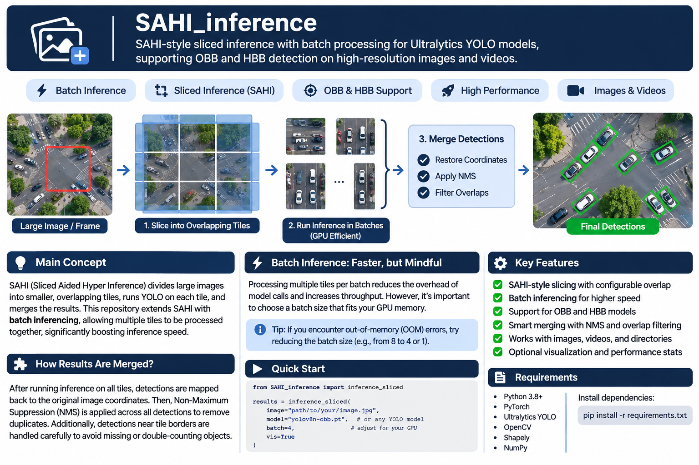
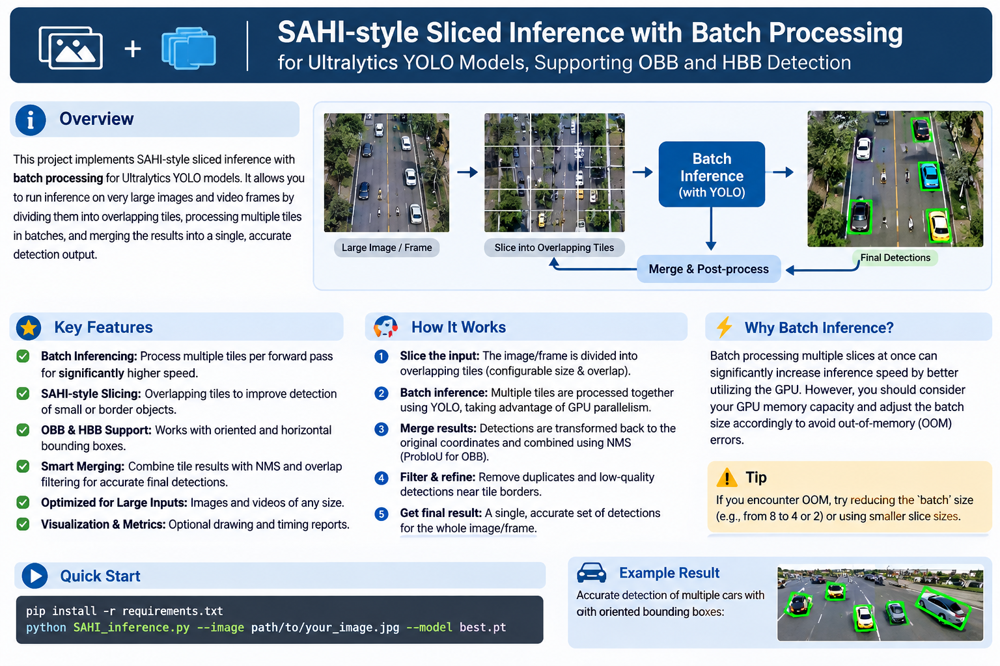

# SAHI Inference — Batched Sliced Inference for Ultralytics YOLO

**SAHI-style sliced inference with configurable batch processing for Ultralytics YOLO models, supporting OBB and HBB detection on high-resolution images and videos.**

## project at glance



This project implements a Slicing-Aided Hyper Inference (SAHI) workflow with a particular focus on **batch inference**. Large images are divided into overlapping tiles, multiple tiles are sent to the YOLO model together, and detections from all tiles are mapped back and merged into one set of detections for the original image or video frame.

The main purpose of tile batching is to avoid making a separate model call for every tile. Processing several tiles in one inference call can reduce repeated-call overhead, improve GPU utilization, and increase throughput. The best batch size depends on the model, tile dimensions, and available GPU memory.

## Why batch inference?

In a one-tile-at-a-time workflow, the model is called repeatedly for each crop of the original image. This implementation groups tiles into batches and passes each group to Ultralytics YOLO in a single call.

For example, if an image produces 20 tiles and `batch=4`, the inference loop submits up to four tiles per model call instead of making 20 individual calls. The final batch may contain fewer tiles when the total number of tiles is not divisible by the batch size.

**Important:** `batch` is the number of image tiles processed together for one image/frame. It is not the number of video frames processed simultaneously.

Batching can improve inference speed, but larger batches require more GPU memory. If the batch is too large for the available GPU, inference may fail with an out-of-memory (OOM) error. Choose the batch size according to your GPU capacity and the size of the tiles.

## How it works

The processing pipeline has four main stages:

1. **Slice the image:** The input image or video frame is divided into smaller, potentially overlapping tiles. Tile dimensions and overlap ratios are configurable. Overlap helps retain objects that cross tile boundaries and improves coverage near the edges of adjacent tiles.
2. **Run batched inference:** The tiles are grouped according to the `batch` parameter. Each group is passed to the Ultralytics YOLO model, which performs inference on the tile images.
3. **Restore coordinates and merge detections:** Each tile's detections are translated from tile-local coordinates into the coordinate system of the original image. Once detections from every tile have been collected, cross-tile NMS and an additional overlap filter remove duplicate detections.
4. **Return frame-level results:** The output is one consolidated list of detections for the original image or video frame, rather than separate results for each tile.

### How tile detections become one final detection set

Every tile is associated with its top-left offset `(x1, y1)` in the original image. YOLO returns box coordinates relative to that tile. The implementation restores the original-image coordinates by adding the tile offset:

- **HBB (horizontal bounding boxes):** the tile's `(x, y)` offset is added to the box coordinates. Width and height remain unchanged.
- **OBB (oriented bounding boxes):** the same offset is added to each of the four polygon corner points. The box center is shifted by the offset while its dimensions and rotation remain unchanged.

This coordinate restoration is essential: it puts detections from different tiles into a shared coordinate system so they can be compared and merged correctly.

#### Edge-aware confidence adjustment

Objects can be cut off when they lie on a tile boundary. To account for potentially incomplete detections, the implementation checks whether a detection touches the edge region of its tile. If any relevant box edge or OBB corner is within approximately five pixels of a tile boundary, its confidence is reduced by `0.05` before merging. This is a small confidence adjustment, not a replacement for overlap or NMS filtering.

#### Cross-tile Non-Maximum Suppression

After all tile detections have been restored to original-image coordinates, the code performs NMS across the complete set:

- **OBB:** uses `TorchNMS.fast_nms` with Probabilistic IoU (`batch_probiou`).
- **HBB:** uses `TorchNMS.fast_nms` with standard box IoU (`box_iou`).

Class-specific coordinate offsets are applied before NMS so detections from different classes do not suppress one another. The `iou_thresh` parameter controls this cross-tile suppression stage.

#### Additional overlap filtering

After NMS, a second polygon-based filtering stage is applied separately to each class. Detections are sorted by confidence, highest first. A lower-confidence candidate is discarded when the intersection area with an already-kept detection covers at least `overlap_thresh` of the candidate's area. This helps remove detections that are mostly contained within a stronger detection.

The result is a single, consolidated set of detections in the original image coordinate system.

## Example visualization

The following image is an **illustrative car-detection example** showing the kind of final frame-level visualization this workflow is intended to produce. It is not a benchmark result or a prediction generated from your trained model.



## Features

- **Configurable tile batching:** process multiple image tiles in each YOLO inference call.
- **SAHI-style slicing:** configurable tile height, width, and horizontal/vertical overlap.
- **OBB and HBB support:** supports Ultralytics models with `obb` and `detect` tasks.
- **Coordinate restoration:** maps tile-level detections back to the original image or frame.
- **Cross-tile NMS:** uses Probabilistic IoU for OBB and standard IoU for HBB.
- **Overlap filtering:** removes detections largely covered by higher-confidence detections of the same class.
- **Edge-aware confidence adjustment:** reduces confidence for detections close to tile boundaries.
- **Test-Time Augmentation:** can forward YOLO's augmentation option during inference.
- **Image and video processing:** supports individual images, video files, and directories of images.
- **Optional visualization:** saves images or annotated videos with the final detections.
- **Timing information:** reports slicing, inference, post-processing, visualization, and total execution times.

## Installation

Clone the repository and install the dependencies:

```bash
git clone <YOUR_REPOSITORY_URL>
cd <YOUR_REPOSITORY_DIRECTORY>
pip install -r requirements.txt
```

PyTorch must be installed with a build compatible with your hardware and CUDA environment. Check the [official PyTorch installation guide](https://pytorch.org/get-started/locally/) and select the appropriate installation command for your system. If needed, install the matching PyTorch build before installing the remaining requirements.

## Usage

The main entry point is `inference_sliced()` in `SAHI_inference.py`. It accepts an image path, video path, or directory path, together with a YOLO model path or a preloaded Ultralytics YOLO model instance.

### Image inference

```python
from ultralytics import YOLO
from SAHI_inference import inference_sliced

# Load your trained YOLO model
model = YOLO("best.pt")

results = inference_sliced(
    image="path/to/large_image.jpg",
    model=model,
    threshold=0.5,
    slice_h=1024,
    slice_w=1024,
    overlap_h=0.2,
    overlap_w=0.2,
    batch=4,
    iou_thresh=0.5,
    device=0,
    tta=False,
    vis=True,
    overlap_thresh=0.5,
)

print(f"Total detections: {len(results)}")
print(results)
```

You can also provide the model path directly; `inference_sliced()` will load it as an Ultralytics YOLO model:

```python
results = inference_sliced(
    image="path/to/large_image.jpg",
    model="best.pt",
    batch=4,
)
```

### Video inference

The same function can process a video. Each frame is handled independently: its tiles are batched, detections are merged into one result set for that frame, and processing then moves to the next frame.

```python
results = inference_sliced(
    image="path/to/video.mp4",
    model=model,
    threshold=0.5,
    slice_h=1024,
    slice_w=1024,
    overlap_h=0.2,
    overlap_w=0.2,
    batch=4,
    iou_thresh=0.5,
    device=0,
    vis=True,
)
```

Video results are returned as a list of `(frame_index, frame_detections)` pairs.

### Directory of images

Pass a directory path to process all supported image files in that directory:

```python
results = inference_sliced(
    image="path/to/images/",
    model=model,
    batch=4,
    vis=True,
)
```

The return value is a dictionary where each key is an image filename and each value is that image's final detection list.

### NumPy image input

For an image already loaded as a NumPy array, call `SliceDetect()` directly:

```python
import cv2
from ultralytics import YOLO
from SAHI_inference import SliceDetect

model = YOLO("best.pt")
frame = cv2.imread("path/to/image.jpg")

results = SliceDetect(
    image=frame,
    model=model,
    batch=4,
    slice_h=1024,
    slice_w=1024,
    overlap_h=0.2,
    overlap_w=0.2,
    vis=False,
)
```

## Main parameters

| Parameter | Default | Description |
|---|---:|---|
| `image` | — | Path to an image, video, or directory of images. `SliceDetect()` also accepts a NumPy image array. |
| `model` | — | Path to YOLO weights or a preloaded Ultralytics YOLO model. The model task must be `detect` or `obb`. |
| `threshold` | `0.5` | Confidence threshold passed to YOLO inference. |
| `slice_h` | `640` | Tile height in pixels. |
| `slice_w` | `640` | Tile width in pixels. |
| `overlap_h` | `0.2` | Vertical overlap ratio between adjacent tiles, from `0` to less than `1`. |
| `overlap_w` | `0.2` | Horizontal overlap ratio between adjacent tiles, from `0` to less than `1`. |
| `batch` | `5` | Maximum number of tile images grouped into one YOLO inference call. This is the key parameter for batch inference. |
| `iou_thresh` | `0.5` | IoU threshold used by the cross-tile NMS stage. |
| `device` | `0` | Inference device passed to Ultralytics, e.g. GPU index `0` or `"cpu"`. |
| `tta` | `False` | Enables or disables YOLO test-time augmentation. |
| `vis` | `False` | Saves visualizations of the final detections. |
| `overlap_thresh` | `0.5` | Minimum fraction of a candidate detection's area covered by a higher-confidence detection for the additional overlap filter to remove it. |

Additional keyword arguments are forwarded to the Ultralytics inference call.

## Choosing the batch size

Batch size is an important performance setting and should be selected according to the available GPU memory.

- Start with a small batch size, such as `1`, `2`, or `4`.
- Increase it gradually while monitoring GPU memory and inference throughput.
- If you encounter CUDA out-of-memory errors, reduce `batch`. Reducing `slice_h` and `slice_w` or using a smaller YOLO model may also reduce memory use.
- Larger tiles generally contain more image data and can require more memory per tile.
- Increasing overlap creates more tiles, which increases the total amount of inference work for each image or frame.

A larger batch does not always mean faster inference. The best setting depends on GPU capacity, model size, tile dimensions, image resolution, and the amount of overlap. Measure performance on your own workload.

## Supported inputs and model types

**Image formats:** JPG, JPEG, PNG, BMP, TIF, TIFF, WEBP, GIF

**Video formats:** MP4, AVI, MOV, MKV, M4V, WMV, FLV, WEBM, MPEG, MPG, TS, M2TS, MTS, 3GP, OGV

**Model tasks:**

- `detect` — horizontal bounding box (HBB) detection.
- `obb` — oriented bounding box detection.

Other Ultralytics task types are not handled by the current implementation.

## Output format

For a single image, `inference_sliced()` returns a list of detection dictionaries. Each detection contains:

| Key | Description |
|---|---|
| `bbox_xyxy` | Four polygon corner points in original-image coordinates. For OBB these are the oriented box corners; for HBB the horizontal rectangle is represented by its four corners. |
| `bbox_xywhr` | Supplementary box parameters from the model (`xywhr` for OBB and `xywh` for HBB). |
| `class_name` | Predicted class name. |
| `conf` | Adjusted detection confidence. |

Return types by input:

- **Image:** a list of final detections.
- **Video:** a list of `(frame_index, detections)` pairs, one entry per processed frame.
- **Directory:** a dictionary mapping each image filename to its list of detections.

When `vis=True`, image visualizations are saved under `runs/image_inference_results/`. Annotated videos are saved in a newly numbered directory under `runs/`, such as `runs/inference_1/`.

## Implementation overview

The main functions in `SAHI_inference.py` are:

| Function | Role |
|---|---|
| `generate_slices()` | Creates overlapping tile coordinates for an image. |
| `process_obb_results()` | Restores OBB detections to original-image coordinates and adjusts confidence near tile edges. |
| `process_hbb_results()` | Restores HBB detections to original-image coordinates and adjusts confidence near tile edges. |
| `apply_nms_obb()` | Merges OBB detections using Probabilistic IoU-based NMS. |
| `apply_nms_hbb()` | Merges HBB detections using standard IoU-based NMS. |
| `delete_overlapping_det()` | Applies the additional polygon-overlap filter. |
| `SliceDetect()` | Runs sliced, batched inference on one image or NumPy frame. |
| `video_inference()` | Processes a video frame by frame using `SliceDetect()`. |
| `inference_sliced()` | Main entry point that dispatches to image, video, or directory inference. |

## Notes

- The `batch` parameter controls how many **tiles from one image/frame** are sent together to the model; it does not batch multiple video frames.
- All tile detections are merged only after their coordinates have been restored to the original frame.
- Batch size, tile dimensions, and overlap should be tuned together for the target GPU and dataset.
- The example car image above is illustrative. Replace it with a visualization generated by your own model when adding project-specific results or benchmarks.
